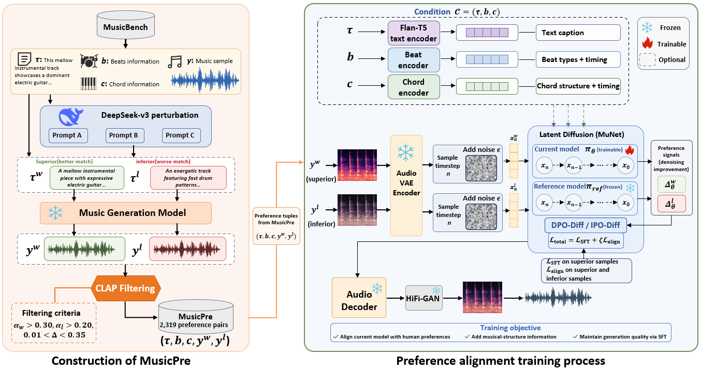

# MusicSPO: Improving Structural Adherence in Music Generation through Structure-Aware Preference Optimization
 

**Abstract**: Existing music generation models can accept conditions such as beats and chords, yet accurately following specified rhythmic and harmonic targets 
remains challenging. We propose MusicSPO, a framework that improves musical structural adherence through structure-aware preference optimization. 
MusicSPO constructs preference data through large language model-driven musical-structure caption perturbation, providing pairwise supervision for comparing
candidate music under shared structural conditions. By jointly optimizing a generative objective on preferred music samples and a pairwise preference 
objective, the framework further improves the model’s ability to follow existing structural conditions. Experimental results show that MusicSPO 
improves beat matching and tonal similarity over the pretrained Mustango baseline, while achieving higher subjective ratings for music quality and text–music 
relevance. Controlled comparisons across structural conditions and training methods further show that structural inputs and preference supervision 
jointly affect structural adherence, with gains varying across condition configurations.

  


--- -->
## 1 Installation

```bash
git clone https://github.com/your-username/MusicAlign.git
cd MusicAlign

conda create -n music_align python=3.10 -y
conda activate music_align

pip install torch==1.13.1+cu117 torchaudio==0.13.1+cu117 --extra-index-url https://download.pytorch.org/whl/cu117

pip install -r requirements.txt

cd diffusers
pip install -e .
```

## 2 Main Results Reproduce
### 2.1 Training Preparation
Download datasets and place them under `./dataset`.

### 2.2 Path Configuration
| Argument | Default Value | Description |
|----------|-------------|-------------|
| `--dataset_dir` | `~/.cache/huggingface/datasets` | Dataset root directory |
| `--train_file` | `{PROJECT_ROOT}/Dataset/MusicPre/train.json` | Training data JSON file |
| `--validation_file` | `{PROJECT_ROOT}/Dataset/MusicPre/validation.json` | Validation data JSON file |
| `--test_file` | `{PROJECT_ROOT}/Dataset/MusicPre/test.json` | Test data JSON file |
| `--output_dir` | `None` | Model & checkpoint output directory |
| `--unet_model_config` | `None` | UNet config JSON |
| `--learning_rate` | `9.6e-7` | learning rate |
| `--num_train_epochs` | `40` | Total training epochs |
| `--per_device_train_batch_size` | `1` | Batch size per GPU |
| `--gradient_accumulation_steps` | `8` | Gradient accumulation steps |
| `--num_warmup_steps` | `0` | Linear warmup steps |
| `--max_train_samples` | `-1` | Max training samples (-1 = all) |
| `--align_type` | `dpo` | Alignment method: `dpo` or `ipo` |
| `--dpo_beta` | `0.5` | DPO temperature coefficient |
| `--eta_ipo` | `0.5` | IPO eta parameter |
| `--zeta` | `0.5` | Weight of Alignment loss |
| `--sft_first_epochs` | `1` | Number of SFT-only warmup epochs |
| `--d_fme` | `1024` | Fourier Music Encoder dimension |
| `--d_pe` | `1024` | Positional encoding dimension |
| `--d_beat` | `1024` | Beat embedding dimension |

### Training a Model

```bash
bash MusicAlign-train.sh
```

---

## Checkpoint *(coming soon)*

---


## Inference

Use `inference_only.py` for text-to-music generation. It supports three input modes:

### Mode 1: Direct text prompts (no beats/chords)

Best for quick generation from plain text. Beats/chords conditioning is automatically disabled.

```bash
python inference_only.py \
    --model_path ./output_dpo/epoch_3 \
    --unet_config configs/diffusion_model_config_munet.json \
    --prompts "A cheerful piano melody" "A calm jazz piece with saxophone" \
    --output_dir ./outputs
```

### Mode 2: Direct prompts + separate music-feature file

When you want beats/chords conditioning with `--prompts`, supply a JSON lines file
via `--features_json`. Each line must correspond 1:1 to a prompt in `--prompts`.

```bash
python inference_only.py \
    --model_path ./output_dpo/epoch_3 \
    --unet_config configs/diffusion_model_config_munet.json \
    --prompts "A cheerful piano melody" "A calm jazz piece" \
    --features_json ./my_features.jsonl \
    --output_dir ./outputs
```

Example `my_features.jsonl`:

```json
{"beats": [[0.5, 1.0], [4, 4]], "chords": ["C:maj", "G:maj"], "chords_time": [0.0, 2.0]}
{"beats": [[0.33, 0.67], [3, 4]], "chords": ["D:min", "A:min"], "chords_time": [0.0, 1.5]}
```

### Mode 3: JSON lines input file (full pipeline)

Same format as training data. Beats/chords are auto-detected from the file.

```bash
python inference_only.py \
    --model_path ./output_dpo/epoch_3 \
    --unet_config configs/diffusion_model_config_munet.json \
    --input_json /path/to/test_prompts.json \
    --text_key main_caption \
    --output_dir ./outputs
```
---
### Dataset *(coming soon)*
---
<!-- ## Citation

If you use this work, please cite:

```bibtex
@misc{musicalign2026,
  title={MusicDPO: Direct Preference Optimization for Text-to-Music Generation},
  author={Your Name},
  year={2026},
  note={Coming soon}
}
``` -->
<!-- 
## License

[Specify your license] -->
